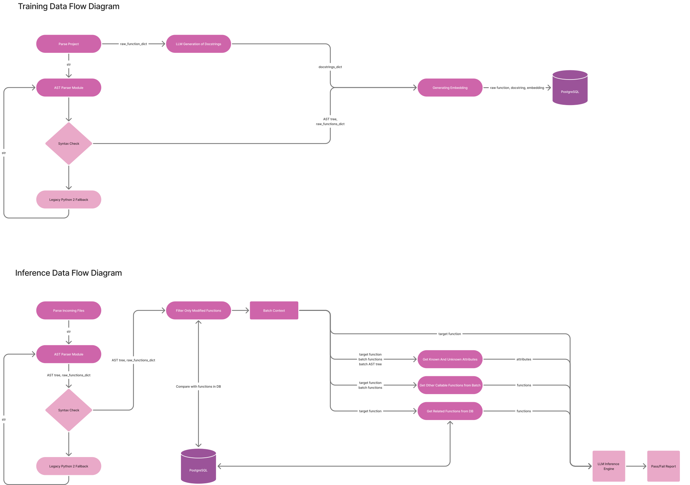

## Data Flow Diagrams

<picture>
  <source media="(prefers-color-scheme: dark)" srcset="docs/DFD_Dark.svg">
  <source media="(prefers-color-scheme: light)" srcset="docs/DFD_Light.svg">
  
</picture>

### Базовый запуск (с GPU)
```
docker-compose up -d
docker-compose -f docker-compose.yml -f docker-compose.gpu.yml run --rm --build app python src/pipelines/training_pipeline.py
docker-compose -f docker-compose.yml -f docker-compose.gpu.yml run --rm --build app python src/pipelines/update_pipeline.py
docker-compose -f docker-compose.yml -f docker-compose.gpu.yml run --rm --build app python src/pipelines/inference_pipeline.py
```

### Запуск без GPU
```
docker-compose up -d
docker-compose run --rm --build app python src/pipelines/training_pipeline.py
docker-compose run --rm --build app python src/pipelines/update_pipeline.py
docker-compose run --rm --build app python src/pipelines/inference_pipeline.py
```

docker-compose down -v
localhost:8080

## Пайплайн обучения базы знаний (`training_pipeline`)
Этот процесс запускается для первичной или полной индексации всего проекта, чтобы нейросеть получила "память" (векторную базу).

1. **Фиксация времени:** `save_last_run()` записывает текущий timestamp, чтобы `update_pipeline` знал, от какой точки искать новые файлы в будущем.
2. **Извлечение структуры (AST):** `extract_project_ast_code_structure()` обходит все Python-файлы проекта. Внутри она вызывает `extract_ast_code_structure()`, которая с помощью класса `CodeExtractor` разбирает синтаксические деревья. На выходе сохраняются два JSON-файла: иерархия классов/импортов и сырой код всех функций (`raw_functions`).
3. **Осмысление кода (LLM):** `create_docstrings()` читает файл с сырым кодом и прогоняет каждую функцию через `generator.generate_docstring()`. Здесь Ollama генерирует сжатое техническое описание (1-2 предложения) для каждой функции. Результат пишется в новый JSON.
4. **Сборка контекста:** `merge_ast_and_docs()` берет голую структуру из шага 2 и вставляет в нее осмысленные описания из шага 3, подготавливая единый документ.
5. **Векторизация и запись в БД:** `export_to_rag()` читает собранный документ и в цикле передает каждую функцию в `process_item()`. Там происходит обращение к Ollama (`client.embeddings()`) для превращения текста описания в математический вектор. После этого код, описание и вектор сохраняются в PostgreSQL (`INSERT INTO code_knowledge_base`).

## Пайплайн инференса (`inference_pipeline`)
Этот процесс работает как строгий ревьюер при получении нового коммита (измененных файлов).

1. **Поиск новых файлов:** `process_incoming_files()` сканирует папку `/app/incoming` и собирает список файлов, которые прислал разработчик.
2. **Точечное извлечение:** В цикле для каждого файла вызывается `extract_functions_from_file()`, которая с помощью AST вырезает из файлов только актуальные блоки функций и методов. 
   - Базовая попытка: Скрипт пробует построить синтаксическое дерево встроенным ast.parse(), ожидая валидный Python 3. Если синтаксис чист, код передается в CodeExtractor. 
   - Вмешательство `run_2to3`: Если возникает SyntaxError (например, встречается старый синтаксис print "hello" без скобок), скрипт сохраняет текст во временный файл и запускает системную утилиту lib2to3 через subprocess. Эта утилита пытается автоматически переписать старый код на современный лад. 
   - Борьба с отступами: Если конвертация провалилась, скрипт предполагает, что проблема в классическом смешивании табов и пробелов (Python 3 этого не прощает). Он применяет .expandtabs(8), заменяя табы на пробелы, и снова прогоняет код через run_2to3. 
   - Зачистка конфликтов: На лету скрипт заменяет async= на is_async=. В старом коде async часто использовали как обычное имя переменной, но в современных версиях это строгий оператор, мгновенно ломающий парсер.
3. **Фильтрация мусора (Экономия токенов):** Собранные функции передаются в `filter_modified_functions()`. Эта функция делает легкие `SELECT` запросы к PostgreSQL и посимвольно сравнивает новый код со старым. То, что не изменилось (например, соседние функции в файле), выбрасывается. Остается только `batch_changes`.
4. **Сборка данных для анализа:** Для каждой реально измененной функции вызывается `analyze_function()`, внутри которой происходит магия RAG:
   - `extract_class_attributes()` анализирует AST целевой функции, вычисляя известные и неизвестные атрибуты `self.*`.
   - `get_project_context()` вызывает `get_db_dependencies()`. Она генерирует вектор из нового кода и ищет в PostgreSQL самые близкие по смыслу старые функции (через косинусное расстояние `<=>`).
   - `get_batch_context()` вызывает `find_called_functions_in_code()`, чтобы проверить, не вызывает ли проверяемая функция другие функции из этого же коммита.
5. **Генерация вердикта (LLM):** `analyze_function()` собирает целевой код, контекст базы, контекст коммита и атрибуты в один гигантский промпт и отправляет его в `client.generate()` (флагманскую модель анализатора).
6. **Финальный отчет:** Пайплайн получает ответы, фильтрует их, форматирует и выводит в консоль итоговый `IMPACT ANALYZER REPORT`.


Где проект будет блистать: Отлов опечаток в переменных, потерянные return в блоках исключений, передача лишних аргументов (kwargs) и несовпадение базовых сигнатур. Заземление через принудительное цитирование заставит модель ловить эти баги практически со 100% вероятностью, если нужный контекст есть в промпте.
Слепота к бизнес-логике: Промпт заточен на структурную целостность. Если разработчик напишет if x > 10 вместо if x >= 10, или ошибется в математической формуле, модель этого не заметит.

Зависимость от RAG: Это самое слабое место в продакшене. Если векторный поиск в PostgreSQL не найдет функцию, которая вызывает модифицированный код, и не подкинет ее в [EXISTING RELATED FUNCTIONS FROM REPO], модели просто не с чем будет сравнивать return и она пропустит баг.

Размытие внимания на больших коммитах: Если в [TARGET FUNCTION CODE] прилетит функция на 300 строк со сложным ветвлением, 14-миллиардная модель снова начнет "терять" инструкции из-за перегрузки контекстного окна.